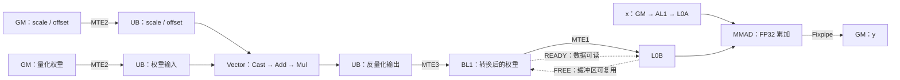

# Kernel WQGMM Mix Antiquant

> [代码位置](../../../../include/blaze/gemm/kernel/kernel_wqgmm_mix_antiquant.h)

## 功能说明

该 Kernel 完成按行分组的权重反量化矩阵乘：将输入 `x` 的行分给不同专家，每个专家使用自己的量化权重、反量化参数和可选 bias，结果按原来的行顺序写入 `y`。

在 Ascend 960 上，每个矩阵计算核 AIC 配对一个向量计算核 AIV。AIV 将权重反量化为 FP16 或 BF16，AIC 执行矩阵乘加（MMAD）并写出结果。

### 维度与计算公式

| 符号 | 含义 |
| --- | --- |
| `E` | 专家数，即分组数 |
| `M` | 输入的总行数，也是输出的总行数 |
| `M_e` | 第 e 个专家处理的行数，所有 `M_e` 之和为 M |
| `K` | 输入通道数，也是矩阵乘的累加维度；所有专家相同 |
| `N` | 输出通道数；所有专家相同 |

令 `A` 为 x 的数据类型，`Round_A` 表示舍入到该类型。对第 e 个专家：

```text
w0[k,n] = Cast_A(weight[e,k,n])
w1[k,n] = Round_A(w0[k,n] + offset[e,n])    // 无 offset 时 w1 = w0
w2[k,n] = Round_A(w1[k,n] * scale[e,n])
y_e     = Cast_A(Matmul_FP32(x_e, w2) + bias[e,:])
```

`Matmul_FP32` 表示使用 FP32 累加；bias 在该输出块的第一次矩阵乘累加时参与，之后沿 K 继续累加。无 bias 时省略 bias 加法。


## 输入与输出

输入和输出均使用 ND 格式，即按下表维度顺序连续存储的普通数组。x、weight、y 各由一个 Tensor 承载，weight 的专家维包含在这个 Tensor 内。

| 参数 | 类型 | 连续存储形状 | 含义 |
| --- | --- | --- | --- |
| x | FP16 / BF16 | `[M,K]` | 各专家的输入行连续拼接 |
| weight | INT8 / FP8 E4M3FN / FP8 E5M2 / HiFloat8 | `[E,K,N]` 或 `[E,N,K]` | 每个专家一份权重，方向见下表 |
| scale | 与 x 相同 | `[E,N]` | 每专家、每输出通道一个缩放系数 |
| offset | 与 x 相同 | `[E,N]` | 可选，仅 INT8 权重使用，先加偏移再乘 scale |
| bias | FP16 x 配 FP16；BF16 x 配 BF16 或 FP32 | `[E,N]` | 可选，沿该专家的输入行广播 |
| groupList | INT64 | `[E]` | 描述各专家的输入行数 |
| y | 与 x 相同 | `[M,N]` | 按输入行顺序拼接的输出 |

### 权重方向与存储方式

两个字母依次描述 x 和 weight 的矩阵方向：`N` 表示不转置，`T` 表示转置。本 Kernel 的 x 始终不转置，因此有两种权重存储方式：

| 方向 | 每个专家的计算表达式 | weight 的连续存储 | 最内层连续维度 | 示例的 `trans` |
| --- | --- | --- | --- | --- |
| NN | `x_e × weight_e` | `[E,K,N]` | N | 0 |
| NT | `x_e × weight_eᵀ` | `[E,N,K]` | K | 1 |

反量化参数始终按输出通道 n 选取。两种方向在数学上都对应一个 `[K,N]` 逻辑权重矩阵。
例如 `K=2,N=3`，逻辑权重为 `[[1,2,3],[4,5,6]]`：NN 的存储序列为 `1,2,3,4,5,6`；NT 为 `1,4,2,5,3,6`。

BlockMmad 的 `LayoutB` 以 `(N,K)` 坐标描述权重，与上述数学坐标的顺序不同。组装模板时使用以下映射：

| 方向 | BlockMmad 的 `LayoutB` | Kernel 按 `(E,K,N)` 构造的 Tensor layout |
| --- | --- | --- |
| NN | `dn_ext_layout_ptn` | `nd_ext_layout_ptn` |
| NT | `nd_ext_layout_ptn` | `dn_ext_layout_ptn` |

layout 决定对已有存储的访问方式，Kernel 不另做一次 GM 权重转置。

### groupList 的两种表示

`groupListType=1` 使用每组行数（count）；`groupListType=0` 使用累计行数（cumsum）。例如三个专家分别处理 2、0、3 行：

| groupListType | groupList | 输入行分配 |
| --- | --- | --- |
| 1：count | `[2,0,3]` | 专家 0 处理行 0–1；专家 1 为空；专家 2 处理行 2–4 |
| 0：cumsum | `[2,2,5]` | 与上一行相同 |

count 的和、cumsum 的最后一项均等于 M。cumsum 非递减，count 非负。空专家不产生计算任务，后续专家仍使用自己的 weight、scale 和 bias。

## 模板组装与参数

Kernel 是 `GemmUniversal` 在 `KernelWqgmmMixAntiquant` 调度类型下的特化。

| 模板参数 | 本数据流的配置 |
| --- | --- |
| `ProblemShape_` | `BlockSchedulerGmmSwatWithTailSplit::ProblemShape`，保存 `(M,N,K,1)` |
| `BlockMmad_` | `MatmulWithWeightAntiquant` 对应的 [BlockMmad](../block/block_mmad_wqmm_mix_weight_prologue.md) |
| `BlockEpilogue_` | `BlockEpilogueEmpty`；结果转换和写回在 BlockMmad 中完成 |
| `BlockScheduler_` | [BlockSchedulerGmmSwatWithTailSplit](../block/block_scheduler_gmm_swat_with_tail_split.md)，负责专家内的 M/N 分块和跨专家任务分配 |

在组装处直接声明 `MatmulWithWeightAntiquant<1,256,2,QuantMode::PERCHANNEL_MODE,HasAntiquantOffset_,KernelWqgmmMixAntiquant>`，选择本 Kernel 的调度类型和单 AIV 配置。offset 布尔参数决定是否执行加法。UB 输入/输出槽数统一取 `UB_MTE2_BUFFER_NUM=2`，各自独立轮转；BL1 使用双槽，AIC 复用 WQMM 的 BlockMmad。

### Params

调用接口为 `__aicore__ inline void operator()(const Params& params)`。

| 字段 | 类型 | 填写方法 |
| --- | --- | --- |
| problemShape | `ProblemShape` | `(M,N,K,1)`，第四项固定为 1；专家数由 groupNum 单独传入 |
| mmParams | `BlockMmad::Params` | 完整 K、bias 开关，以及 L1/L0 的分块尺寸，详见 BlockMmad 文档 |
| schedulerParams | `BlockScheduler::Params` | `{baseM,baseN}`，与 mmParams 的 M/N 基本块一致 |
| x、weight、scale、y | `GM_ADDR` | 各自的单元素 TensorList 描述符地址；描述符中的元素指向上表的完整 Tensor |
| offset、bias | `GM_ADDR` | 各自的单元素 TensorList 描述符地址；未启用时填 nullptr |
| groupList | `GM_ADDR` | INT64 数组的直接地址 |
| groupNum | `uint32_t` | 专家数 E |
| groupListType | `uint32_t` | 0 为累计行数，1 为每组行数 |

TensorList 的长度为 1，和专家数 E 是两个不同概念。例如 weight 的一个列表元素指向完整 `[E,K,N]` 或 `[E,N,K]` 数组。Kernel 解析描述符后立即构造 Tensor，专家和矩阵子块通过 `slice` 切片选取，随后用 `squeeze` 移除长度为 1 的专家维。

### 调用契约

调用方在启动 Kernel 前完成参数构造与合法性检查。非空计算的 `M、N、K、E` 均为正，`problemShape` 为 `(M,N,K,1)`。分块参数描述最大基本块，尾块的有效尺寸由调度器和 K 循环取得。

| 项目 | 调用要求 |
| --- | --- |
| K 维度 | `mmParams.kSize == problemShape.K`，AIC 矩阵乘与 AIV 反量化使用同一完整 K。 |
| L0 基本块 | `l0TileShape=(baseM,baseN,kL0)`；无 bias 时 baseM=256，有 bias 时 baseM=240；`baseN=min(256,Align16(N))`，`kL0=min(64,Align16(K))`。Align16 表示向上补齐为 16 的倍数。 |
| L1 分段 | `l1TileShape=(baseM,baseN,kL1,kL1)`，其中 `kL1=4*kL0`，Ka 与 Kb 相等。kL0、kL1 均非零，kL1 最大 256；该配置使用共享 BlockMmad 的分段加载路径。 |
| 调度参数 | `schedulerParams=(baseM,baseN)`，与 L1/L0 基本块的 M/N 一致；调度所得每个块均位于对应专家的有效输出域内。 |
| 必需地址 | x、weight、scale、y 为有效的单元素 TensorList 描述符地址，描述符中的元素地址有效；groupList 为至少 E 个 INT64 的直接设备地址。各数据区覆盖“输入与输出”表所列 shape/dtype，地址满足对应类型和搬运接口的对齐要求。 |
| 可选参数 | `mmParams.hasBias=true` 时 bias 的描述符及数据有效；`Policy::HAS_ANTIQUANT_OFFSET=true` 时 offset 的描述符及数据有效。未启用时相应地址可为 nullptr。 |
| 分组内容 | `groupListType` 只能为 0 或 1；count 非负且总和为 M，cumsum 非负、非递减且最后一项为 M。空专家占用一个列表位置，对应 weight/scale/bias 的专家索引保持不变。 |
| 启动与资源 | 使用 `KERNEL_TYPE_MIX_AIC_1_1`、`AIV_NUM=1`，在入口初始化 SoC 状态；启动核数不超过平台可用 AIC 数。当前目标为 `NPU_ARCH=9201`，每 AIV 可用 UB 为 376 KiB，前处理固定分区占 259 KiB。L1 为 512 KiB，L0A/L0B 各 64 KiB，L0C 为 256 KiB；同一次调用中的其他组件不得覆盖已分配区域。 |
| 存储生命周期 | 输入、TensorList 描述符、groupList 和输出存储保持有效，直至承载本次 Kernel 的 stream 执行完成。 |

K 一致性保证两侧产生相同数量、相同有效 K 范围的 BL1 段，使 READY/FREE 通知一一对应。正的 kL0/kL1 保证 BlockMmad 的分块除法及循环步长有效；baseN、kL1 的上限使一个 L1 权重段能够放入 256×256 的 UB 输入槽。Kernel 直接使用这些参数，不为非法 Params 或 device groupList 内容生成运行时诊断。

### 调用示意

以下类型组装使用 FP16 输入、INT8 权重、不转置权重、无 offset 和无 bias：

```cpp
#include "blaze/gemm/block/block_scheduler_gmm_swat_with_tail_split.h"
#include "blaze/gemm/kernel/kernel_universal.h"

using NdLayout = asc::te::nd_ext_layout_ptn;
using DnLayout = asc::te::dn_ext_layout_ptn;
using Policy = Blaze::Gemm::MatmulWithWeightAntiquant<
    1, 256, 2, Blaze::Gemm::QuantMode::PERCHANNEL_MODE, false, Blaze::Gemm::KernelWqgmmMixAntiquant>;
using Mmad = Blaze::Gemm::Block::BlockMmad<
    Policy, half, NdLayout, AscendC::Std::tuple<int8_t, half>,
    AscendC::Std::tuple<DnLayout, NdLayout>, half, NdLayout, half, NdLayout>;
using Scheduler = Blaze::Gemm::Block::BlockSchedulerGmmSwatWithTailSplit;
using Kernel = Blaze::Gemm::Kernel::GemmUniversal<
    Scheduler::ProblemShape, Mmad,
    Blaze::Epilogue::Block::BlockEpilogueEmpty, Scheduler>;
```

在声明 `KERNEL_TYPE_MIX_AIC_1_1` 并调用 `AscendC::InitSocState()` 的设备入口内填充参数。例如 E=3、M=5、K=17、N=19，groupList 使用 `[2,0,3]`：

```cpp
Kernel::Params params{};
params.problemShape = {5, 19, 17, 1};
params.mmParams.kSize = 17;
params.mmParams.hasBias = false;
params.mmParams.l1TileShape = {256, 32, 128, 128};
params.mmParams.l0TileShape = {256, 32, 32};
params.schedulerParams = {256, 32};
params.x = xList;
params.weight = weightList;
params.scale = scaleList;
params.y = yList;
params.groupList = groupListAddr;
params.groupNum = 3;
params.groupListType = 1;
Kernel{}(params);
```

`xList/weightList/scaleList/yList` 为调用方准备的列表描述符地址，`groupListAddr` 指向三个 INT64 元素。实际启动的 AIC 数由 launch 的 block 数指定。完整的内存分配、描述符构造与启动代码见[调用示例](../../../../examples/acl/grouped_matmul/grouped_matmul_weight_antiquant/README.md)。

## 计算流程与缓冲区

Kernel 按专家顺序取得输入行区间，再由调度器分配 M/N 输出块。每对 AIC/AIV 使用相同的任务顺序：AIV 为该输出块逐段转换权重，AIC 逐段累加同一个输出块。



GM 为片外存储；UB 为 Vector 使用的片上缓冲区；AL1、BL1 分别是 L1 中保存 x 和转换后 weight 的区域。MTE2 负责 GM→UB/L1，MTE3 负责 UB→L1，MTE1 负责 L1→L0，Fixpipe 将累加结果转换并写回 GM。图中的虚线表示核间同步。

### 前处理配置与参数视图

入口通过具名常量设置 `AIV_COUNT=1`、`UB_BUFFER_COUNT=2` 和 `POLICY_UB_INNER_BYTES=256`。`POLICY_UB_INNER_BYTES` 作为共享 Policy 的接口兼容参数；GMM 的实际 UB 几何由 `GroupedWeightAntiquantConfig` 定义。

`MatmulWithWeightAntiquant` 的第四、第五、第六个参数分别为量化模式、offset 开关和 Kernel 调度类型。GMM 显式选择 `PERCHANNEL_MODE`、`KernelWqgmmMixAntiquant`，并设置 `AIV_NUM=1`。Kernel、前处理和 BlockMmad 检查单 AIV 约束，设备入口使用 `KERNEL_TYPE_MIX_AIC_1_1`。

`GroupedWeightAntiquantConfig` 根据量化模式和 weight 类型选择前处理配置，集中描述 GM/UB weight 布局、输入容量、转换块尺寸、输出布局和参数空间。当前特化处理 INT8、FP8 E4M3/E5M2、HiFloat8 的逐通道反量化，并将输入连续维跨度与外层尺寸显式传给 `Antiquant` Tile。配置复用 Tile 层的 `IS_ANTIQUANT_W8` 类型判断，计算各区域大小，并检查 32 B 对齐和转换子块的 C0 对齐。UT 根据输出区起点、槽数和输出槽大小计算 UB 总占用，核对 265,216 B（259 KiB）的预算。

`ANTIQUANT_DEFAULT_OUTER_SIZE` 定义默认 VF 外层长度 128，由 Tile 模板默认参数和 GMM 配置共同引用；它与表示寄存器容量的 `F16_LANES` 分别定义。

`AntiquantTileConfig<TransB,OuterSize,Mode,WeightType>` 同时供 Kernel 和 Tile 使用，按量化模式、weight 类型和方向选择转换块及输出布局参数。`AntiquantTileBase` 直接按量化模式和 weight 类型在编译期分派，配置与分派共用 W8 类型判断 `IS_ANTIQUANT_W8`；W8 逐通道适配 `RunW8PerChannel` 将完整 Tensor 视图转换为 VF 指令参数，输入第二寄存器起点与输出寄存器起点分别由配置描述。`AntiquantImplBase` 保存 Cast、可选 Add、Mul 和写回函数。

扩展 W4 时，可增加对应的配置特化、Tile 适配分支和独立 VF，并在 GMM 配置及参数视图中定义打包输入和量化参数布局。通用 Tensor 入口与模式分派可复用，W8 的寄存器取址约定只用于 W8 适配。当前 W4 和未实现量化模式在编译期拒绝。

`GroupedAntiquantParameterViews` 管理 scale/offset 的 Tensor 视图：从 `[E,N]` 中选择当前专家和输出通道，再选取输入段及转换子块所需参数。逐通道参数沿 K 不变；bias 独立使用 `[E,N]` 布局。专家和子块通过 Tensor slice 表达，物理地址仅在入口解析及缓冲区分配时使用。

`GroupedWeightAntiquant` 负责预取、输入/输出槽轮转、转换调用与 BL1 通信。一个 BL1 段对应一个 UB 输入块，单次 weight MTE2 搬入该段有效权重。每个输出任务的第 0、1 个 K 段分别向当前输入槽装入 scale/offset；后续 K 段复用本槽参数，单段任务只装入一份。任务内段序号从 0 开始，全局输入槽计数跨任务和专家延续。下一任务重新加载其使用的参数槽。当前 Tile 执行独立 Cast、可选 Add 和 Mul。

前处理以 `Policy::ANTIQUANT_TYPE == QuantMode::PERCHANNEL_MODE` 选择任务内参数复用，其他量化模式按段搬入参数。weight 和所需参数的搬运都在输入槽 MTE2 锁内，Vector 持有输入槽锁直至该块全部转换完成。参数复用不跳过 weight copy、锁或 BL1 握手；不维护缓存键和有效标记，UB 布局及 259 KiB 预算保持一致。


### 分块与 UB 布局

`baseM/baseN` 为输出基本块的行数和列数，`kL0` 为一次矩阵乘的 K 长度，`kL1` 为一次 L1 权重块的 K 长度。当前配置为无 bias 时 baseM=256、有 bias 时 baseM=240；baseN 最大 256，kL0 最大 64，kL1=4×kL0，最大 256。小 N/K 向上按 16 元素对齐。

| 缓冲区 | 单份容量 | 份数 | 保存内容 |
| --- | ---: | ---: | --- |
| UB 输入 | 66,560 B | 2 | 最大 256×256 个 8-bit 权重，以及各 256 个 scale/offset |
| UB 输出 | 66,048 B | 2 | 一次 Vector 函数（VF）的 FP16/BF16 结果及布局间隔 |
| 合计 | 265,216 B，即 259 KiB | — | 输入和输出各自轮转 |

一个完整 256×256 权重块分两次 VF 处理：NN 沿 K 分成两个 128×256 子块；NT 沿 N 分成两个 256×128 子块，最终拼到同一个 BL1 块。
输出按每组 16 元素组织，每组跨度为 `129×16` 个元素，包含额外一行布局间隔。尾块使用有效区域的 Tensor slice 搬运；搬运所需的 16 元素补齐区域包含在本次 VF 的写入区域内。

### 核间同步

BL1 使用两份缓冲区，按全局段序号模 2 交替使用，两个槽共用 mode 4 的 READY=9、FREE=8 计数信号。AIV 完成一段全部 UB→L1 搬运后，在 MTE3 上发送 READY；AIC 在 MTE1 上等待 READY，再读取该段权重。该段最后一次 L1→L0B 读取完成后，AIC 在 MTE1 上发送 FREE。首次两段免等 FREE，后续每段生产前顺序消费一个 FREE，退出时再消费最后实际存在的一或两个 FREE。空任务不产生握手，每个方向最多有两个未消费通知。


AIV 通过 `utils/sync.h` 的 `NotifyCube/WaitForCube` 在 MTE3 上握手；AIC 沿用 WQMM 的 `CrossCoreWaitFlag/CrossCoreSetFlag`，在 MTE1 上按 `AivNum_` 判断是否处理第二个 AIV。

## 配套资料

- [BlockMmad](../block/block_mmad_wqmm_mix_weight_prologue.md)：AIC 接口、L1/L0 分区、bias 和尾块处理。
- [调用示例](../../../../examples/acl/grouped_matmul/grouped_matmul_weight_antiquant/README.md)：CSV 配置、编译运行及精度校验。
- [调度与布局 UT](../../../../tests/ut/op_kernel/weight_quant_grouped_matmul/README.md)：测试结构和运行入口。
