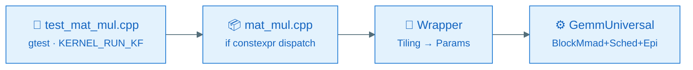
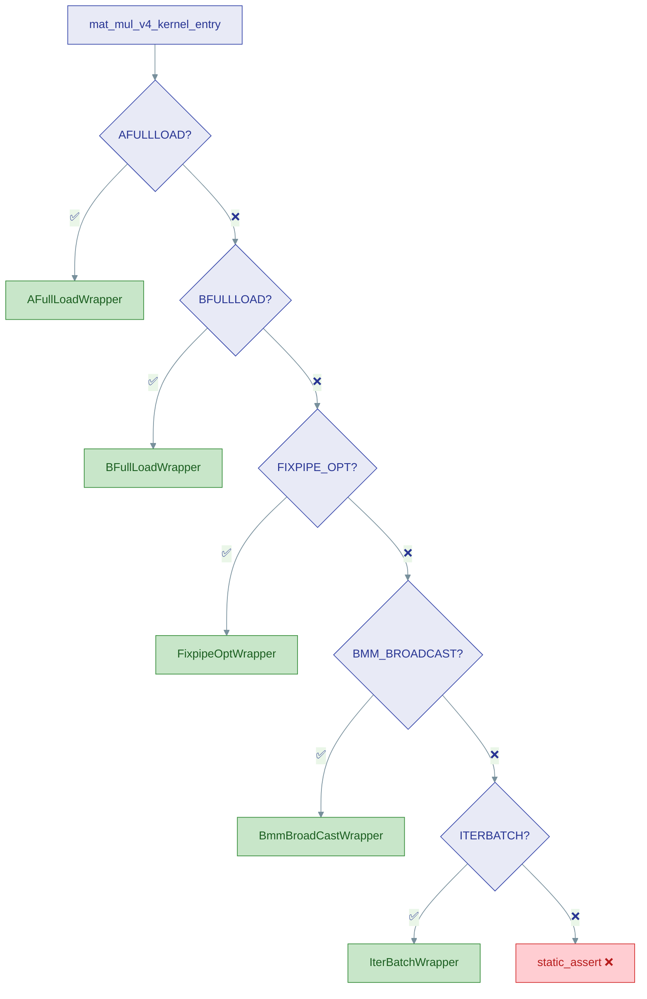
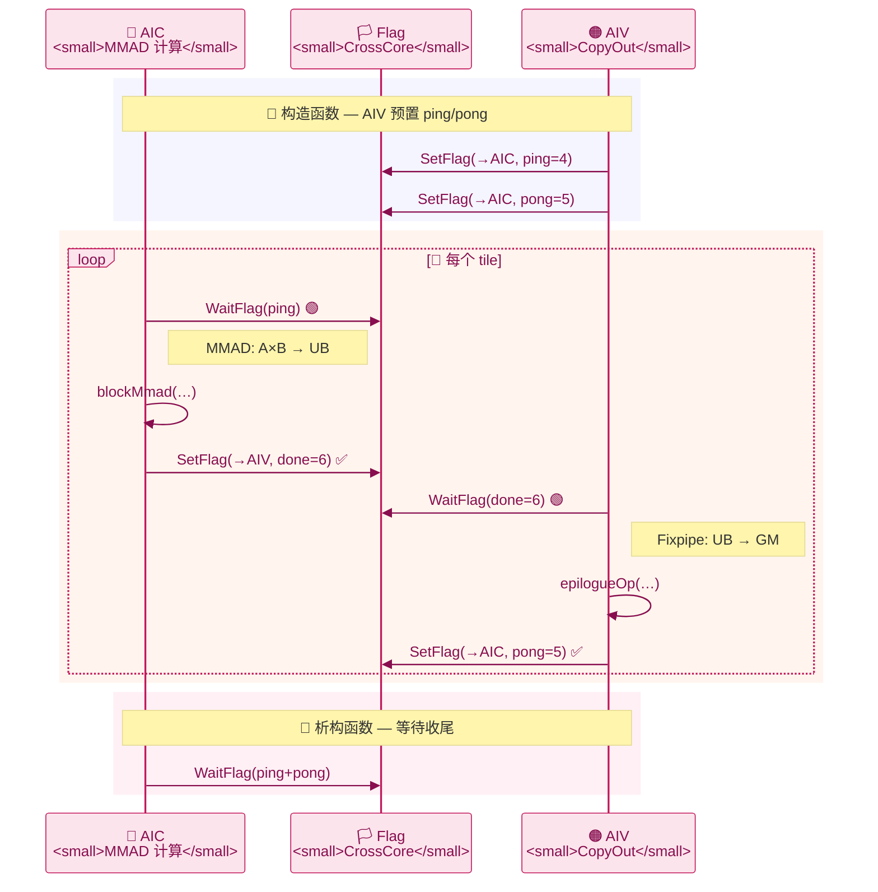

# ops-tensor Kernel UT

## 1. 功能说明

Kernel UT 基于 Google Test 框架，用于验证算子 Kernel 实现的编译正确性和基本功能：

- 验证各算子变体（StreamK、Basic、AFullLoad、BFullLoad、FixpipeOpt 等）在 NPU 模拟器上的编译和 CPU 侧执行
- 通过 `KERNEL_RUN_KF` 宏捕获 kernel 子进程的 crash / exit 状态，解决 `ICPU_RUN_KF` 无法传播子进程失败的问题
- 支持按算子、按 SoC 维度灵活选择编译和测试范围

## 2. 环境依赖

| 依赖         | 最低版本      | 用途                                       |
| ------------ | ------------- | ------------------------------------------ |
| cmake        | 3.16          | 构建系统                                   |
| g++          | 默认 ≥ C++17 | Host 侧 C++ 编译器                         |
| bisheng      | —            | ASC 语言编译器（随 CANN Toolkit 安装）     |
| CANN Toolkit | ≥ 9.1.0      | 提供 tikicpulib、ACL 运行时、头文件        |
| gtest        | —            | 由 cmake 通过`fetch_cann_cmake` 自动获取 |

> `build.sh --opkernel -u` 会在编译前自动执行 `git submodule update --init include/tensor_api`，确保 Blaze 编译依赖就绪。

## 3. 目录结构

```
tests/
└── ut/
    ├── README.md                             # 本文件
    └── op_kernel/                            # Kernel UT 入口（仓库唯一测试套件）
        ├── CMakeLists.txt                    # 工程入口：注册算子、编译 kernel 可执行文件
        ├── test_op_kernel_main.cpp           # gtest 主入口（InitGoogleTest + RUN_ALL_TESTS）
        ├── kernel_ut_runner.h               # KERNEL_RUN_KF 宏（stdout 捕获 → 崩溃检测）
        ├── blaze_kernel_stub.h              # __aicore__ / AscendC API CPU stub
        ├── k3_pvwrap.cpp                     # tikicpulib 桩函数
        │
        └── {op}/                             # 算子级目录
            ├── CMakeLists.txt                #   AddOpTestCase(op_name socs flags)
            ├── test_{op}.cpp                 #   测试用例（gtest TEST_F）
            ├── {op}.cpp                      #   各变体 kernel entry 统一分发
            ├── mat_mul_{variant}.h           #   变体 wrapper（host → kernel 桥接）
            └── mat_mul_tiling_data.h         #   Tiling 数据结构定义
```

**构建入口**：

| 入口 | 命令 | 说明 |
| ---- | ---- | ---- |
| build.sh（推荐） | `bash build.sh --opkernel -u` | 独立构建目录 `build/kernel_ut/`，自动 submodule → cmake → 编译 → 运行 |
| build.sh 主路径 | `bash build.sh --run` | `--run`/`-u` 统一委托 Kernel UT 流程（仓库唯一测试套件） |
| 根 CMake | `cmake -DBUILD_TESTING=ON ..` | 根工程 `BUILD_TESTING` 选项委托 `add_subdirectory(tests/ut/op_kernel)` |
| 单独 cmake | `cmake -S tests/ut/op_kernel -B build/kernel_ut` | 独立工程，不依赖根 CMake |

**关键组件说明**：

| 文件                    | 说明                                                                                                                          |
| ----------------------- | ----------------------------------------------------------------------------------------------------------------------------- |
| `kernel_ut_runner.h`  | 提供`KERNEL_RUN_KF(func, numBlocks, args...)` 宏，通过 stdout 重定向 + 文本解析检测子进程崩溃（IPC 信号无法传递时仍然可靠） |
| `blaze_kernel_stub.h` | CPU 模拟环境下`__aicore__` kernel stub，提供 `AscendC::GmAlloc/GmFree`、`AscendC::GetBlockIdx()` 等 CPU 侧模拟 API      |
| `mat_mul.cpp`         | 所有 MatMul 变体的统一入口，基于`if constexpr` 按 `OP_TYPE` 分发到对应 wrapper                                            |

## 4. 执行方法

### 4.1 通过 build.sh 执行（推荐）

```bash
# 执行全部算子 Kernel UT
bash build.sh --opkernel -u

# 执行指定算子
bash build.sh --opkernel -u --ops=mat_mul
bash build.sh --opkernel -u --ops=mat_mul,quant_batch_matmul
```

`build.sh` 会自动完成：submodule 初始化 → cmake 配置 → 编译 → 运行。

SoC 相关行为：

| 命令 | 行为 |
| ---- | ---- |
| 不带 `--soc` | **仅**构建并执行 ascend950 的 UT（默认行为） |
| `--soc=ascend950` | 同上，显式指定 |
| `--soc=<soc1>,<soc2>` | 多 SoC，逗号分隔（各 SoC 见 `KERNEL_UT_SOC_TABLE`） |

### 4.2 执行个别测试用例

完整编译后，到构建目录用 gtest filter 筛选：

```bash
cd build/kernel_ut

# 运行单个用例
./ops_tensor_kernel_ut_ascend950 --gtest_filter='MatMulV3Test.Test_FP16_Basic'

# 运行某类全部用例
./ops_tensor_kernel_ut_ascend950 --gtest_filter='MatMulV3Test.*'

# 列出全部用例名称
./ops_tensor_kernel_ut_ascend950 --gtest_list_tests

# 模糊匹配
./ops_tensor_kernel_ut_ascend950 --gtest_filter='*AFullLoad*'
```

### 4.3 构建产物

| 产物       | 路径                                               |
| ---------- | -------------------------------------------------- |
| 构建目录   | `build/kernel_ut/`                               |
| 可执行文件 | `build/kernel_ut/ops_tensor_kernel_ut_ascend950` |

### 4.4 多 SoC 构建

`KERNEL_UT_SOC`（或 `build.sh --soc=<soc>`）支持逗号分隔的多 SoC，每个 SoC 生成独立的
`ops_tensor_kernel_ut_<soc>` 可执行文件；未指定时构建 `ALL_SUPPORTED_SOCS` 全集。

## 5. 新增算子 UT

以新增算子 `my_op` 为例：

```bash
# 1. 创建算子目录
mkdir -p tests/ut/op_kernel/my_op
```

```cmake
# 2. tests/ut/op_kernel/my_op/CMakeLists.txt
AddOpTestCase(my_op "ascend950pr_9599" "")
```

`AddOpTestCase` 的三个参数：

| 参数                     | 说明                         | 示例                   |
| ------------------------ | ---------------------------- | ---------------------- |
| `opName`               | 算子名称（子目录名）         | `mat_mul`            |
| `supportedSocVersions` | 支持的 SoC 版本字符串（`;` 分隔） | `"ascend950pr_9599"` |
| `extraCompileOptions`  | 额外编译选项（如数据类型宏） | `"-DDTYPE_A=half"`   |

### 5.1 用例级 SoC 隔离（目录约定）

算子目录下可建**架构子目录**，把只属于某一芯片架构的用例与支撑源码隔离出来。
目录名与 SoC 的对应关系由 `KERNEL_UT_SOC_TABLE` 第 3 列决定（见 5.2）。

```
tests/ut/op_kernel/my_op/
├── test_my_op_basic.cpp          # 顶层：编入该算子支持的全部 SoC
└── arch35/                       # 架构目录（名取自 SoC 扩展表）
    ├── test_my_op_prealloc.cpp   # 仅编入该架构对应的 SoC
    └── mx_helper.cpp             # 该架构专属支撑源
```

| 位置 | 编入范围 | 说明 |
| ---- | -------- | ---- |
| `<op>/test_*.cpp` | 该算子 `supportedSocVersions` 中的**全部** SoC | 通用用例 |
| `<op>/<archXX>/test_*.cpp` | **仅** 该架构目录对应的 SoC | 架构专属用例 |
| `<op>/<archXX>/*.cpp`（非 `test_` 开头） | **仅** 该架构目录对应的 SoC | 该架构专属支撑源，照常编译链接 |

规则要点：

- **用例文件一律以 `test_*.cpp` 命名**，顶层与架构目录同规则；非 `test_` 前缀的 `.cpp`
  不会被当作用例收集，但其编译归属仍跟随所在架构目录。
- 架构目录下的非 `.cpp` 文件（`.h`、`.txt` 等）不参与编译，可作为该架构专属的头文件/资源。
- 隔离发生在**编译期**：不属于当前 SoC 的用例与支撑源都不会进入该 SoC 的对象库，
  因此 `--gtest_list_tests` 看到的用例集合天然就是当前 SoC 的子集，架构专属 API
  也不会在另一架构下编译。
- 若某算子在某 SoC 下没有任何可用源文件，该算子在该 SoC 下自动跳过并打印原因。

### 5.2 新增 SoC（唯一扩展点）

`tests/ut/op_kernel/CMakeLists.txt` 顶部维护一张 SoC 扩展表，**新增 SoC 只需追加一行**：

```cmake
set(KERNEL_UT_SOC_TABLE
    "ascend950|ascend950pr_9599|arch35|dav_3510"
    # 短名     | compute_unit      | 架构目录 | 仿真器架构目录
    # "ascendXXX|ascendXXX_yyyy    | archAA  | dav_ZZZZ"     <- 新增 SoC 按此格式追加一行
)
```

由该表自动派生，无需再改任何 `if/else`：

| 派生项 | 用途 |
| ------ | ---- |
| `ALL_SUPPORTED_SOCS` | 未指定 `KERNEL_UT_SOC` 时构建的 SoC 全集 |
| `KERNEL_UT_ARCH_DIRS` | 参与用例收集的架构目录清单（取自表第 3 列） |
| `map_compute_unit()` | 短名 → compute_unit（`KERNEL_UT_SOC`、`build.sh --soc`） |
| `map_soc_tag()` | compute_unit 长名 / 短名 → 裸 SoC 名 |
| `map_soc_to_arch_dir()` | SoC → 架构目录（用例级隔离） |
| `map_soc_to_sim_arch()` | SoC → `simulator/<arch>/lib` 链接目录 |
| tikicpulib 调试宏剥离目标 | `tikicpulib_<compute_unit>` 列表 |
| `soc_has_cpudebug_runtime()` | 运行时自动探测 CANN 是否提供该架构的 `libcpudebug.so` |

仍需人工处理的两处（属于算子自身声明，不在本表范围）：

1. 各算子 `<op>/CMakeLists.txt` 的 `AddOpTestCase(<op>, "<新增 compute_unit>")`。
2. 若该 SoC 还需算子包/二进制配置（`op_kernel`、`config/<soc>/*.json`），按原有流程补充。

```cpp
// 3. tests/ut/op_kernel/my_op/test_my_op.cpp
#include "gtest/gtest.h"
#include "kernel_ut_runner.h"

class MyOpTest : public testing::Test {
protected:
    GM_ADDR aGM{nullptr};
    // ...
    void SetUp() override { /* 分配 GM 内存 */ }
    void TearDown() override { /* 释放 GM 内存 */ }
};

TEST_F(MyOpTest, Test_Basic) {
    // 设置 tiling 数据 → 获取 kernel 函数指针 → KERNEL_RUN_KF 执行
    auto kernelFunc = my_op_kernel_entry<OP_TYPE_MYOP_BASIC, half, half, half>();
    ASSERT_TRUE(KERNEL_RUN_KF(kernelFunc, blockNum, aGM, bGM, cGM, workspaceGM, tilingGM));
}
```

注册后即可通过以下方式运行：

```bash
bash build.sh --opkernel -u --ops=my_op
```

## 6. 架构图解

### 6.1 调用链路



| OP_TYPE                 | kernel_entry   | Wrapper                               | Kernel 特化                         |
| ----------------------- | -------------- | ------------------------------------- | ----------------------------------- |
| `STREAMK` / `BASIC` | `mat_mul_v3` | `StreamKWrapper` / `BasicWrapper` | `KernelStreamK` / `KernelBasic` |
| `AFULLLOAD`           | `mat_mul_v4` | `AFullLoadWrapper`                  | `KernelAFullLoad`                 |
| `BFULLLOAD`           | `mat_mul_v4` | `BFullLoadWrapper`                  | `KernelBFullLoad`                 |
| `FIXPIPE_OPT`         | `mat_mul_v4` | `FixpipeOptWrapper`                 | `KernelFixpipeOpti`               |
| `BMM_BROADCAST`       | `mat_mul_v4` | `BmmBroadCastWrapper`               | `KernelBmmBroadcast`              |
| `ITERBATCH`           | `mat_mul_v4` | `IterBatchWrapper`                  | `KernelIterBatch`                 |

### 6.2 if constexpr 路由



### 6.3 Fixpipe 双核协作

FixpipeOpti 将计算拆分为 **AIC（Cube MMAD）** 和 **AIV（Vector CopyOut）** 两路，通过 CrossCore Flag 乒乓流水。



**Flag 分配表：**

| 名称        | Flag ID | 方向       | 说明                                   |
| ----------- | ------- | ---------- | -------------------------------------- |
| `ping`    | 4       | AIV → AIC | AIV 完成 copy-out，AIC 可开始下一 tile |
| `pong`    | 5       | AIV → AIC | 乒乓交替                               |
| `done`    | 6       | AIC → AIV | AIC 完成 MMAD，AIV 可开始 copy-out     |
| `ping+16` | 20      | AIV → AIC | splitM 场景 M 轴信号                   |
| `pong+16` | 21      | AIV → AIC | splitM 场景 M 轴信号                   |
